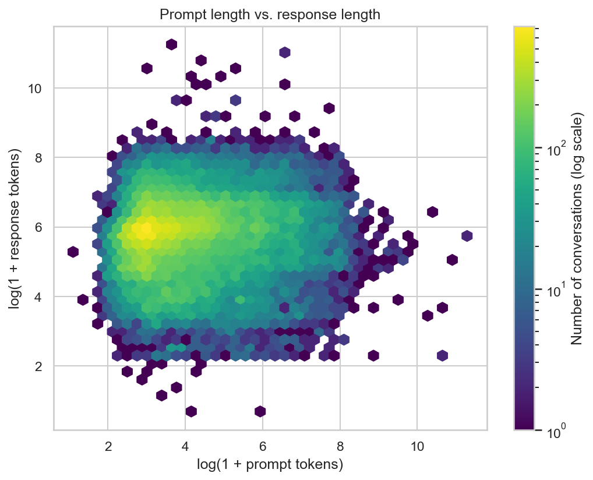
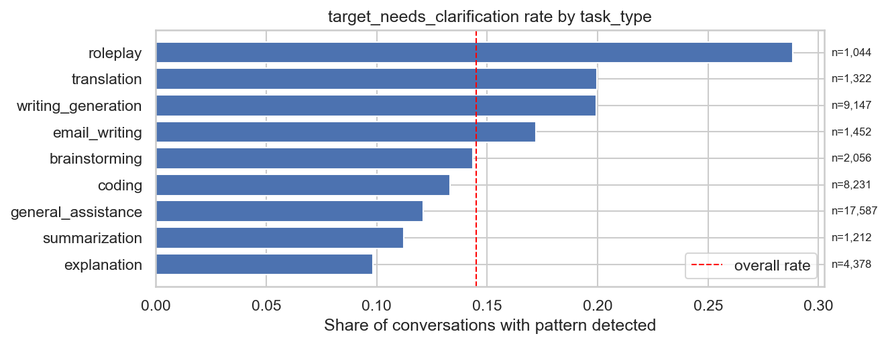

# LLM Sustainability Analysis

How are prompt characteristics related to response length and to simple response patterns in LLM conversations? This project builds a reproducible data pipeline on a ShareGPT-style dialogue dataset, explores the relationships, and trains first baseline models. Response length (in tokens) is used as a **proxy** for computational demand. Energy use is **not** measured.

> **Status: paused, exploratory.** Data preparation, feature and target engineering, exploratory analysis and first baseline models are done. Controlled prompt experiments, tuning, calibration and any direct energy estimate are not done.

## Key findings (current data, 46,429 conversations)

- **Prompt length barely predicts response length.** Spearman correlation 0.07. Only very short prompts (up to ~13 tokens) get noticeably shorter answers (median 271 vs. 329-370 tokens); beyond ~18 tokens the median is flat.
- **Response length is extremely right-skewed:** median 337, mean 498, maximum 76,828 tokens (skewness 39.7, or -0.35 after `log1p`).
- **Role instructions stand out.** Prompts with "act as ..." receive shorter responses (median 247 vs. 347 tokens) and trigger the clarification pattern about twice as often (24.6% vs. 12.6%). Format instructions go with longer responses (median 379 vs. 325 tokens). These are associations, not causal effects.
- **Clarification patterns depend on the task:** from about 10% of responses for explanations to about 29% for roleplay.
- **The response-pattern targets are rare:** refusal 2.3% (1,049), capability 1.0% (483), needs-clarification 14.5% (6,728).
- **Topic modelling found one large general cluster:** 55% noise, 41% general, only 4% technical or domain topics, so topic features carry little information.





## Model results

Baseline classifiers predict whether a response shows a pattern (refusal, capability statement, clarification) from the prompt. Train/test split and cross-validation are **grouped by prompt**, so identical prompts never appear on both sides. Values below are for feature set v03 (structural + semantic features + 384-dimensional embeddings). CV = 5-fold cross-validated ROC-AUC on the training part; Test = holdout; AP = Average Precision on the holdout (a random ranking scores the positive rate).

| Target (positive rate) | LR CV | LR Test | LR AP | RF CV | RF Test | RF AP |
|---|---:|---:|---:|---:|---:|---:|
| `target_refusal` (2.3%) | 0.694 | 0.704 | 0.053 | 0.706 | 0.713 | 0.071 |
| `target_capability` (1.0%) | 0.721 | 0.747 | 0.028 | 0.719 | 0.781 | 0.086 |
| `target_needs_clarification` (14.5%) | 0.761 | 0.778 | 0.434 | 0.771 | 0.775 | 0.446 |

- **Moderate signal.** Clarification is the most predictable target (AP about three times the base rate). Refusal and capability are only weakly predictable; the capability holdout has about 100 positives, so its test scores are noisy and the cross-validated values are more reliable.
- **Embeddings carry the signal.** Adding them raises cross-validated ROC-AUC by about 0.07 to 0.12. Embeddings alone (v04) are as good as v03 (CV difference at most 0.006). v03 is used for interpretation because it keeps the interpretable prompt features, not because it performs better.
- **Logistic Regression and Random Forest perform alike** with the grouped split. An earlier run with a random split showed a much higher Random Forest score (test ROC-AUC about 0.83), most likely because it recognised repeated prompts.
- **Engineered features help only the non-linear model:** for the Random Forest, v02 beats v01 (for example refusal 0.62 vs. 0.53 CV ROC-AUC); for Logistic Regression they barely matter.
- **Interpretation (Logistic Regression, v03):** in SHAP the embedding block makes up 96-97% of the summed importance, which is largely a counting effect of 384 columns. Random Forest SHAP gives the same picture (embeddings 93-98%); beyond the embeddings, prompt length matters most for refusal and capability, and embedding novelty and role instructions for clarification. For clarification (Logistic Regression), summarisation (odds ratio 0.63) and explanation prompts (0.83) lower the odds, writing/generation (1.30), roleplay (1.22) and role instructions (1.25) raise them.
- Thresholds were not tuned. At 0.5 the Random Forest predicts almost no positives and Logistic Regression predicts many with low precision, so the models are suitable for ranking only. Full tables: [`03_reports/analysis_summary_models.md`](03_reports/analysis_summary_models.md).
- Ridge regression on the log response length showed no meaningful predictive power in earlier experiments, consistent with the weak prompt-length relationship above. The notebook for it is not part of this repository.

## Pipeline

Run the notebooks in this order. Each notebook reads the file written by the previous one.

| # | Notebook | Purpose | Output |
|---|---|---|---|
| 1 | `01_data_cleaning_filtering` | Language filter for the first user prompt, comparison of filter settings | filtered conversations (JSON) |
| 2 | `02_feature_target` | Prompt features, validation, embeddings, BERTopic, targets | feature table *v1-1-0*, embeddings |
| 3 | `03_data_exploration` | Quality checks, distributions, target analysis, adds log columns | feature table *v1-2-0*, figures |
| 4a | `04_sustainability_modelling_log_reg` | Logistic Regression baselines, coefficients, SHAP | `03_reports/results_log_reg.csv` |
| 4b | `04_sustainability_modelling_ran_forest` | Random Forest classifiers, SHAP | `03_reports/results_random_forest.csv` |

```text
01_data/          not tracked (raw data, processed data, embeddings)
02_notebooks/     analysis notebooks
03_reports/       model result tables and written summary
figures/          plots used in this README
```

**Setup:** Python 3.11, then `uv sync` (dependencies are listed in `pyproject.toml`). The embedding and topic-model steps in notebook 02 are compute-heavy. The data are not part of this repository: download the dataset from **[SOURCE LINK]** and place `sg_90k_part1.json` and `sg_90k_part2.json` in `01_data/01_raw/messy_dataset/`.

## Data and processing

| Step | Conversations |
|---|---:|
| Raw (ShareGPT-style, two files) | 90,665 |
| After strict English filter (notebook 01) | 47,960 (52.9%) |
| After validation (notebook 02): empty prompt or response 1,319, noise marker or too short ~200 | 46,432 |
| After orthographic-error-rate cutoff (<= 0.58) | 46,429 |

The English filter combines a stopword heuristic, Latin-letter, non-ASCII and digit checks, and the Lingua language detector in strict mode (English, confidence >= 0.75). Five filter settings were compared; the final one is the most conservative and favours clean English data over volume.

Only the first user prompt and its first response are analysed. Responses in the source data contain HTML markup, which is removed before the regex targets are applied.

## Targets

- **`target_cost`:** number of tokens in the first response (`log1p`-transformed for regression). A proxy for response-related compute, not a measurement of energy.
- **`target_refusal`, `target_capability`, `target_needs_clarification`:** regex-based flags on the first response (`1` = pattern found). They are rough operationalisations. "Needs clarification" is detected through clarification phrases and any question mark in the response, so code, lists and URLs can trigger it.

## Feature sets

| Set | Content |
|---|---|
| v01 | Structural: prompt length, question count, spelling error rate, instruction flags |
| v02 | v01 + task type, topic category, embedding novelty, topic probability |
| v03 | v02 + 384-dimensional sentence embeddings |
| v04 | Embeddings only |

Only information available when the prompt is written is used as a feature. Quantities derived from the response or from later turns (for example total tokens or follow-up flags) are excluded; notebook 02 checks that every column has an explicit role.

## Limitations

- **Observational data.** The analysis shows associations, not causal effects of prompt design.
- **Proxy, not energy.** Token counts ignore model size, hardware, batching and infrastructure.
- **Language filter and prompt length.** The strict filter shifts the prompt-length distribution: the median first prompt grows from 15 to 36 words, and the share of prompts under 10 words drops from 36.5% to 5.7%. In a manual check of 30 random removed prompts with 5-9 words, 20 were valid English (mostly short, lowercase keyword-style queries). Correct short English prompts are therefore under-represented, and findings about prompt length describe medium and long prompts.
- **Markup in response length.** 99.9% of first responses contain HTML markup. `target_cost` counts tokens of the raw response, so it includes markup: after cleaning, a response has a median of 78% of its raw tokens. The rank correlation between raw and cleaned token counts is 0.93, so relative conclusions should be robust, but absolute token numbers are overstated.
- **Pattern-based, overlapping targets.** Regex flags miss implicit or differently worded behaviour. Refusal and capability patterns share phrases: 271 of the 483 capability matches (56%) are also refusal matches. Good prediction from embeddings partly reflects that certain prompt types (for example requests to open a URL) trigger standard replies.
- **Duplicate prompts.** 19.3% of the cleaned first prompts occur more than once. Splits are grouped by prompt, but near-duplicates (paraphrases) can still end up on both sides.
- **Rare positives.** Capability has few positive cases (483), so small differences between feature sets are within noise.
- **Weak topic features.** The topic model found one dominant general cluster, and the topic categories were assigned by hand for this specific run.

## Potential future work

- Repeated cross-validation with confidence intervals; SHAP for the Random Forest
- Cleaned token counts as the cost target
- Manual annotation of a sample to estimate the precision of the regex targets
- Language detection that handles short prompts better, or relaxed rules for short prompts
- Finer topic structure (smaller clusters or a different clustering)
- Threshold tuning, probability calibration, gradient boosting, and a documented Ridge baseline for response length
- Controlled prompt experiments (same task, systematically varied prompt properties)
- Combine token counts with published energy estimates under explicit assumptions

## Tools

Python, pandas, NumPy, scikit-learn, SHAP, Sentence Transformers, BERTopic, UMAP, HDBSCAN, Lingua, tiktoken, matplotlib, seaborn, Jupyter.
